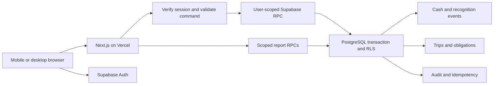

# VanLedger — Architecture

Status: proposed design. This document specifies a future implementation; it does not mean any service, schema, or package has been created.

## 1. System shape and decisions

Use a modular Next.js App Router application deployed on Vercel, with Supabase Auth and PostgreSQL as the identity/data layer. Keep one deployable application and one database; a two-partner business does not justify microservices. Business IDs are tenancy boundaries; vehicle IDs are attribution boundaries, not tenants.

| Decision | Rationale and consequence |
| --- | --- |
| Server Components for authenticated reads | Keep secrets and privileged report queries off the client; send only authorized, serialized DTOs. |
| Client Components at interactive boundaries | Forms, bottom navigation behavior, dialogs, and Recharts need browser interaction; avoid a fully client-rendered application. |
| Server Actions for web mutations; Route Handlers for exports/integrations | Both validate input and invoke the same application services. Do not create two financial rule implementations. |
| User-scoped Supabase client for every request | Verified identity and RLS remain effective; financial writes use narrow authenticated RPCs. No service-role key needed for routine app flows. |
| PostgreSQL financial commands | Cash posting, allocations, authorization, idempotency, constraints, and audit commit together. Multiple HTTP calls cannot approximate a transaction. |
| Immutable cash and recognition events | Corrections remain traceable; cash and period reports can be reproduced as of a cutoff. |
| One business finance lock | Serialize financial mutations per business; predictable correctness at this scale. Measure before attempting finer-grained locks. |
| Exact money in domain and SQL | PostgreSQL bigint / TypeScript bigint, decimal-string DTOs; never calculate money from chart coordinates or floating-point values. |
| One currency and logical cash pool | Meets initial reporting needs; multi-currency/accounts are explicit later migrations. |
| No offline mutations in v1 | Avoid premature conflict resolution and accidental duplicate money entry. Preserve an explicit failure/retry experience. |

No new worktree is necessary: each cloud task is already isolated. Use the existing checkout unless the user explicitly requests a worktree.

## 2. Runtime boundaries



The browser can use Supabase Auth's public URL/key. A public publishable/anonymous key is not a permission grant; RLS and JWT determine access. Normal financial mutations go through Next.js validation and database RPCs, but database authorization must also withstand an attacker calling RPC directly.

Use a supported Supabase SSR cookie integration. Verify identity using `getUser()` or the current officially supported verified-claims mechanism; never trust `getSession()` payload alone as authorization. Use request-scoped clients, secure cookies, verified redirect allowlists, and refresh handling. Route middleware/proxy (name depends on pinned Next.js version) may refresh sessions and redirect; it is not the sole authorization boundary.

## 3. Proposed repository structure

```text
app/
  (auth)/                         sign-in, callback, password recovery
  (business)/b/[businessId]/      dashboard and all scoped modules
    trips/                       list, detail, create, collect, costs
    vehicles/                    expenses, EMI plans, renewals
    partners/                    funding, repayments, distributions
    reports/                     periods and drilldowns
    settings/                    owner administration and audit
  api/exports/                   authorized CSV handlers
  manifest.ts                    generated public application manifest
components/
  ui/                            reviewed shadcn/ui primitives
  shell/                         sidebar, header, bottom navigation
  financial/                     money, balances, cards, exact tables
features/
  trips/ vehicles/ partners/ reports/ settings/
    components/ schemas/ services/ server/
lib/
  auth/ supabase/ money/ dates/ permissions/ errors/
supabase/
  migrations/ tests/ seed/        versioned SQL and synthetic fixtures
tests/
  unit/ integration/ e2e/
public/
  icons/                         regular, maskable, Apple touch icons
```

This is a planned layout, not authorization to create directories now. Use vertical feature modules with shared domain utilities; avoid feature-to-feature UI imports that create circular dependencies. Browser code cannot import `server` modules. Pin supported Next.js/React/TypeScript/Tailwind versions during scaffolding, check shadcn compatibility, and preserve a single lockfile.

## 4. Financial command lifecycle

Example: collect final trip balance.

1. UI receives exact outstanding amount and trip version from a scoped read. Generate an operation UUID when the user confirms the intent; retain it across retries of that intent.
2. Server verifies session, parses amount/date and Zod (or equivalent) schema, determines business from authorized route context, checks basic role access, and calls `post_customer_receipt` with the same UUID and canonical payload.
3. RPC obtains the business finance-state lock, rereads active membership, checks the cutoff/period/policy, and resolves the idempotency record. It locks/checks relevant trip versions and business-scoped relationships.
4. RPC computes outstanding from committed events, including effective-date invariants, validates amount and reference, inserts posting/allocation/audit/command result, and commits as one operation.
5. Server returns exact money as integer strings plus new versions. UI refreshes authoritative totals and announces success. Cache invalidation occurs only after commit.
6. A timeout is an unknown outcome. Retry with the same UUID, not a new payment; the RPC returns the committed result if it exists.

All financial/member/policy mutations take the same business lock first. Owner membership changes must use this path so revocation cannot race authorization. Bootstrap business creation has a separate authenticated atomic function; invite acceptance locks the target business before creating a membership. Deadlock handling should retry the same idempotency key with bounded backoff and return a recoverable conflict if exhausted.

Operational trip edits use a compare-and-swap version (`expected_version`). Recognized price changes, expense adjustments, EMI payment changes, and financial period changes are financial commands, not generic updates. Never retry an edit against a newer version without user review.

## 5. Reads and reports

- RLS protects base-table reads. Financial tables have no direct client write grants. Scope every query and foreign-key relationship by business, even when RLS exists.
- Use SQL report functions for dashboard totals and reconciliation, calculated in one statement or transaction snapshot. Do not aggregate separate paginated client queries into a balance.
- Report DTO includes business ID, currency/exponent, timezone, period, policy version(s), completeness flags, exact totals, and generation timestamp.
- Read active membership on every request; avoid globally cached tenant data. Explicitly disable shared/static caching for authenticated pages, exports, financial handlers, and personalized responses. Prefer uncached private reads initially; any later cache keys include business, permission context, and ledger revision.
- Financial history uses keyset pagination `(business_date, created_at, id)` with a documented stable order. Reports filter by effective date, not insertion timestamp.
- Realtime subscription may request refresh/invalidate data. It is optional and must not calculate balances from messages or substitute for authoritative reads. Realtime requires its own RLS verification.
- Recharts receives bounded display-only numeric values after checked conversion; exact amounts remain in tables/tooltips. If a value exceeds safe display precision, use scaled axes and exact text rather than pass an unsafe integer to the chart.

## 6. Authentication, tenants, and invitations

- Model business membership independently of financial partner identity. User can join more than one business; only an explicitly selected authorized business is shown. Never use a global “current business” singleton on the server.
- Roles are membership data, not client-editable profile fields. A verified user with no membership sees onboarding/invitation state, not any business ledger.
- Invitations use owner-generated, cryptographically random, expiring single-use tokens stored as hashes. Invite acceptance requires a verified identity matching the normalized invitation email through trusted Auth identity lookup. Never accept an email or role merely supplied by the client.
- V1 can let the owner copy an invitation URL. Automated invite email requires a configured provider; do not assume an email service or add credentials without necessity. Use normal signup/sign-in and guarded invite acceptance, avoiding Auth admin APIs in ordinary flows.
- Owners cannot remove/demote the last owner. Specify owner recovery and transfer procedure before production. Removing a member immediately blocks further access; financial partner history remains.

## 7. Security and threat model

| Threat | Required control / verification |
| --- | --- |
| Cross-business ID substitution | RLS, scoped RPC authorization, composite business foreign keys, adversarial tests for all relationship types. |
| Partner invoking owner-only operation | Server and database role checks; direct RPC role tests, not just hidden buttons. |
| Duplicate/concurrent payment | Idempotency hash, finance lock, allocation limits, effective-date validation. |
| Financial record tampering | Revoked direct DML, immutable-event triggers, controlled reversal RPC, atomic audit. |
| Invite theft or privilege escalation | Token hash/expiry/single use, verified email match, fixed owner-chosen role, no last-owner removal. |
| Session/cookie leakage | Request-scoped clients, safe cookie handling, no tokens in logs, origin checks/CSRF defenses for mutations. |
| Cached user data leaked to another user | Explicit private/no-store behavior, deployment tests with separate sessions. |
| XSS and hostile notes/CSV | Escape user content, no raw HTML, CSP adapted to providers, formula-safe CSV fields. |
| Logging/backups revealing private data | Redaction, least access, documented retention, encrypted provider storage/transport. |
| Public Postgres functions bypassing RLS | Revoke PUBLIC execute, explicit role grants, fixed search path, explicit `auth.uid()` and business/role checks. |

Use invoker functions where possible. A narrowly scoped `SECURITY DEFINER` posting function may be needed because authenticated users lack table DML grants; it must have a fixed minimal search path, qualified names, explicit authentication/authorization, no dynamic SQL, and a non-login owner with minimal privileges. Definer functions cannot assume RLS will save them. Avoid recursion in membership RLS through narrowly audited helpers. Views must be security-invoker or replaced by scoped RPCs.

No service-role credentials in browser, public environment variables, source control, logs, or exports. Reserve any future administrative credential for a separately justified server-only capability; it must never be a shortcut around normal tenant authorization. No attachment uploads in v1; add private storage policies and scanning rules if introduced.

Rate-limit sign-in/recovery, invite creation/acceptance, exports, and mutation entry points using supported provider/application controls. Bound report ranges and request sizes. Rate limits complement authorization and idempotency; they do not replace either.

## 8. PWA and resilience

- Serve HTTPS with a manifest specifying name, short name, stable ID, scope, start URL, standalone display, theme/background colors, and 192/512 icons. Provide maskable assets and an Apple touch icon.
- Start URL leads through auth/business selection safely; manifest/icons contain no tenant data. Use local build assets, not external fonts required for basic operation.
- Android install guidance depends on browser capabilities; show prompts only when supported. iPhone uses Safari Share → Add to Home Screen and must be tested directly. Do not promise identical install APIs on both platforms.
- Do not cache authenticated responses or queues in a service worker. If a platform/version needs a minimal worker for its install experience, implement only the tested install requirement without adding financial response caching. Offline support remains a later design task with storage, conflict, logout, and tenant-switch rules.
- Online failure keeps the form values, makes error state explicit, and offers idempotent retry. Warn users before navigating away with unsaved edits. Do not store sensitive form drafts in persistent browser storage by default.
- Live processes and open sessions need not survive an environment snapshot; future start instructions must launch and verify the development server. Configuration scripts must not embed secrets.

## 9. Deployment and configuration

Expected configuration names (no values are defined here):

| Name | Scope | Purpose |
| --- | --- | --- |
| `NEXT_PUBLIC_SUPABASE_URL` | Public | Selected environment's Supabase project URL |
| `NEXT_PUBLIC_SUPABASE_PUBLISHABLE_KEY` | Public | Publishable client key; use the SDK-supported equivalent if required by the pinned release |
| `APP_ORIGIN` | Server, non-secret | Validated application origin for redirects/invite links |
| `SUPABASE_DB_URL` | Migration/CI secret only | Privileged migration connection; never available to browser or routine web requests |

Use separate Supabase/Vercel projects or strictly isolated environments for development, staging, and production. Preview builds must not point to production data. Migration secrets belong in protected CI/provider configuration; inspect existing credential bindings before requesting any new ones.

CI gates: frozen-lockfile install, lint, strict typecheck, focused unit and database tests, production build, then staging E2E. Run migrations with an explicit approved deployment process; never migrate on a page request or unconstrained preview build. Prefer additive migrations and expand/contract changes. Document rollback/forward-fix strategy; a down migration cannot be assumed to recover discarded financial data.

Database/schema changes must be rehearsed on representative staging data and reviewed for locks and RLS. Deployment requires a backup, restore exercise, environment validation, and approved operational targets (D10). Vercel functions are stateless; never use local disk as persistent financial storage.

## 10. Observability and validation

- Add correlation ID, command ID, operation name, safe business/entity IDs, latency, and outcome to structured logs. Never log amounts/notes by default, auth tokens, invite tokens, credential values, or entire request bodies.
- Database audit is the business history; application logs are operational evidence. Alert on error rates, command conflicts, failed backups, and unexpected reconciliation mismatches.
- Unit tests: exact money/date logic and approved financial policies. Database integration tests: migration constraints, RLS, RPC permissions, immutable events, idempotency, concurrency, historical cutoffs. E2E: daily mobile flow, owner/partner differences, auth expiration, failed network, report reconciliation, PWA installation checks.
- Performance and accessibility are measured gates, not assertions inferred from successful build. See [TASKS.md](TASKS.md) for implementation order and release evidence.
