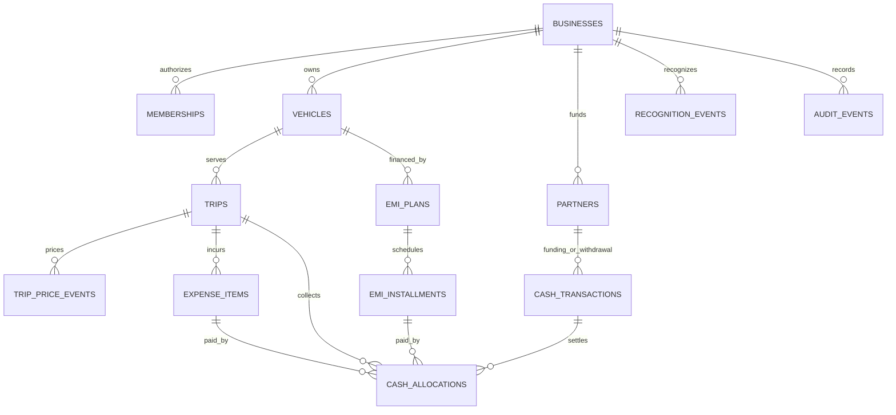

# VanLedger — PostgreSQL Data and Security Design

Status: conceptual schema and command contract for review, not executable SQL migrations. Translate into reviewed versioned migrations only after approval. This schema supports [BUSINESS_RULES.md](BUSINESS_RULES.md); unresolved policies must remain explicit.

## 1. Conventions

- Supabase PostgreSQL, UUID primary keys, `timestamptz` server audit times, `date` business-effective dates, `bigint` money in minor units, integer basis points. Never use `float`, `real`, `double precision`, or PostgreSQL `money` for persisted calculations.
- Every business-owned child table has `business_id NOT NULL`; the root `businesses.id` is the tenant key. A row's identity is globally unique, and `UNIQUE(business_id, id)` permits composite foreign keys to tenant-scoped parents. Do not rely on UUID uniqueness alone to prevent cross-business links.
- Ordinary amounts are positive; signed deltas are allowed only in named event/adjustment columns. Cash direction is a constrained enum. Null means unknown, not zero. Include `created_at`/`created_by` where applicable; creator comes from `auth.uid()`, never caller-supplied attribution.
- Operational records use integer `version` for optimistic updates and `archived_at` rather than destructive deletion. Immutable financial rows never expose generic CRUD updates.
- Currency/exponent come from the immutable-after-use business configuration; posting currency is redundantly validated for defensive reporting. Indexes/constraints must be named in migrations.
- “Required” below means required once the relevant workflow is enabled. Do not fill unapproved policy fields with invented defaults.

## 2. Entities and relationships

Every relationship in this diagram is additionally scoped by the same business. Some cash transactions have no allocations; every allocated transaction must match its permitted target type.

## 3. Business, identity, policies, and cutover

| Table | Main columns | Invariants |
| --- | --- | --- |
| `businesses` | id, name, currency_code, currency_exponent, timezone, fiscal_start_month/day, created_by, version | Currency/timezone are validated against supported catalogs; currency locked after financial use. Fiscal dates must have documented valid-date convention. |
| `memberships` | business_id, user_id → auth.users, role owner/partner, status active/revoked, joined_at | Unique business/user; at least one active owner once business initialized. User deletions cannot cascade into financial/audit deletion. |
| `partners` | id, business_id, display_name, membership_user_id nullable, archived_at | A financial counterparty may exist without login; optional membership link uses business/user composite FK, unique if present. |
| `invitations` | id, business_id, email_normalized, role, token_hash, expires_at, accepted_at, invited_by | Single-use unexpired token; verified identity email match; restricted owner reads/writes. Never store raw token. |
| `business_finance_state` | business_id PK, ledger_revision, cutover_id nullable | One row locked first for financial, membership, and critical policy commands. Revision increments on committed financial changes. |
| `financial_policies` | id, business_id, effective_date, policy_type, validated payload, approved_by/at, supersedes_id | Immutable versions for recognition, EMI conventions, withdrawal permissions, period correction, and future allocation policies; no unchecked JSON dictates posting behavior. |
| `profit_share_versions` | id, business_id, effective_date, approved_by/at, rounding_rule nullable | Immutable; one applicable policy per effective date; enabled only after D05 approval. |
| `profit_share_members` | business_id, share_version_id, partner_id, share_bps | Unique partner/version; each 0..10,000; sum exactly 10,000 verified atomically at activation. Historical versions persist. |
| `financial_periods` | id, business_id, start_date, end_date_exclusive, state open/closed, closed_by/at | No overlapping periods; owner-controlled state; all effective-date mutations check period. Missing period is not implicit authorization. |
| `cutovers` | id, business_id, date, opening_cash_minor signed, provenance, confirmed_by/at | One confirmed baseline; signed amount matches optional opening_cash posting; zero has no cash row. Immutable after use. |
| `opening_partner_advances` | id, business_id, partner_id, cutover_id, amount_minor, provenance | Nonnegative, unique partner/cutover, immutable noncash claim. Corrections require a typed owner opening-position revision, not contribution cash. |
| `opening_equity_positions` | id, business_id, cutover_id, position_type, amount_minor signed, provenance | Optional owner-confirmed retained-earnings/equity inputs; never derived from cash; policy needed before accounting use. |
| `opening_receivables` | id, business_id, cutover_id, customer_label, optional vehicle_id, amount_minor, external_reference | Positive legacy collectible; no current revenue recognition. Legacy trip summaries may reference this claim but cannot create a second collectible amount. |

Initial business/membership/finance-state creation is one authenticated bootstrap command. New business does not expose financial actions until owner confirms configuration/cutover and required policies. Opening-position revisions must preserve as-of claims; exact amendment rules depend on D02/D09 and are not ordinary edits.

## 4. Vehicles, trips, expenses, and financing

| Table | Main columns | Invariants |
| --- | --- | --- |
| `vehicles` | id, business_id, label, registration_number, odometer_unit, archived_at, version | Unit km in proposed v1; unique normalized registration per business if supplied; archives preserve links. |
| `trips` | id, business_id, vehicle_id, name, customer_label/contact nullable, status, start_date, end_date, completion_date nullable, start_odometer/end_odometer nullable, version | End ≥ start; nullable nonnegative readings and end ≥ start; completion date required when completed; financial identity locked after use. |
| `trip_price_events` | id, business_id, trip_id, event_type initial/amendment/correction, amount_delta_minor signed, business_date, reason, policy_id nullable, command_id | Initial agreed amount ≥0; net price cannot be negative or violate net collection rules. Immutable effective-dated price changes. Zero initial price permitted with explicit acknowledgment. |
| `trip_status_events` | id, business_id, trip_id, from_status, to_status, business_date, reason, command_id | Append-only transitions; current `trips.status` is transactionally maintained projection; completed/cancelled corrections require policy and recognition handling. |
| `expense_categories` | id, business_id, code, name, classification operating/finance, archived_at | Seeded reviewed categories; owner extensions cannot silently change old classification. Codes for EMI interest/fee reserved. |
| `expense_items` | id, business_id, category_id, trip_id nullable, vehicle_id nullable, incurred_date, initial_amount_minor, description, origin ordinary/opening_payable/emi_interest/emi_fee, installment_id nullable, cutover_id nullable, version | Amount >0; trip vehicle matches; opening payable requires cutover and is excluded from new recognition. Shared cost can omit vehicle/trip. EMI component origin uniquely linked and protected from manual duplicate creation. |
| `expense_adjustments` | id, business_id, expense_id, amount_delta_minor signed, business_date, reason, command_id | Append-only; net obligation ≥0 and ≥ valid paid allocations at all affected boundaries. Owner correction only; recognizes approved delta separately. |
| `vehicle_renewals` | id, business_id, vehicle_id, kind insurance/road_tax, due_date, completed_at/date nullable, replacement_id nullable, notes, version | No cash amount posting implied; historical renewals retained, new period creates new row. |
| `emi_plans` | id, business_id, vehicle_id, label/lender, original_count, legacy_paid_count, first_due_date, monthly_amount_minor, due_convention_policy_id, legacy_history_mode, attested_by/at, state | Count/amount checks; immutable terms after activation; no unsupported amortization assumptions. Monthly fixed schedule only in initial supported plan mode. |
| `emi_installments` | id, business_id, plan_id, sequence_number, due_date, due_amount_minor, principal_minor/interest_minor/fees_minor nullable, history_state remaining/legacy_settled, legacy_paid_minor | Unique plan/sequence; positive due; all finance components known and sum to due, or all null. Legacy-settled records are metadata, excluded from new cash; ordinary allocations target remaining rows. |
| `accounting_adjustments` | id, business_id, kind, amount_minor signed, business_date, policy_id, reason, reference, command_id | Owner-only approved noncash adjustment; no cash row. Types/recognition mapping enabled only after D08. |

`trips` does not store an independently editable “received total” or “profit.” Current agreed price is the sum of price events, outstanding uses collections, and reports use recognition events. `expense_items` initial amount is immutable; amounts change through adjustments. Derived totals and EMI statuses are computed, not hand-maintained boolean “paid” flags.

If irregular EMI history is not supported at launch, the UI must reject that mode and explain the missing import/amendment feature. The schema may reserve imported history fields, but their existence is not proof the workflow exists. An expense's category/attribution/date correction after recognition is a linked correction/replacement, not destructive modification.

## 5. Immutable cash ledger

### `cash_transactions`

Required columns: `id`, `business_id`, `kind`, `direction` (in/out), `amount_minor > 0`, `currency_code`, `business_date`, `payment_method` (required for actual payments; nullable for baseline/adjustments), `external_reference` nullable, `partner_id` nullable, `share_version_id` nullable, `reversal_of_id` nullable, `replacement_for_id` nullable, `refund_receipt_id` nullable, `reason` nullable, `command_id`, `created_at`, `created_by`.

Supported kinds and normal direction:

| Kind | Direction | Relationship |
| --- | --- | --- |
| customer_receipt | in | Exactly one trip or opening receivable allocation |
| customer_refund | out | Exactly one same-customer target allocation plus original receipt relationship; disabled pending D06 |
| operating_expense_payment | out | Exactly one ordinary/opening expense allocation |
| emi_payment | out | Exactly one remaining instalment allocation |
| partner_contribution | in | Required partner; no settlement allocation |
| partner_advance_repayment | out | Required partner; aggregate claim validation |
| profit_distribution | out | Required partner and approved share version; no advance allocation |
| opening_cash | owner-chosen in/out | One baseline per business; no allocation |
| cash_adjustment | owner-chosen in/out | Owner-only reason/reference; no allocation |

Finance-interest/fee expense obligations are settled by their linked EMI payment, not an additional operating-expense cash transaction. Reports derive their paid component only when a supplied component/payment-allocation policy exists; until then show financing cash separately. Ordinary expense-payment RPC must reject EMI-origin costs.

A reversal has the original kind, amount, currency, targets, and partner/policy links with **opposite direction** and a unique `reversal_of_id`. Direction validation distinguishes reversals from normal entries. It does not erase the original. `replacement_for_id` identifies a correction replacement; reversal and replacement may share one command. Refunds have a separately constrained `refund_receipt_id` pointing to the original customer receipt, not `reversal_of_id`; a legitimate refund is not correction of a data-entry error.

Generic reversal rejects `opening_cash`; its single baseline is immutable in v1. An opening-amendment feature needs the explicit D02/D09 event model before activation, not an exception to the baseline constraint. Reversal/replacement validations evaluate the full proposed transaction's net effects, not temporary insert ordering within the transaction.

### `cash_allocations`

Columns: `id`, `business_id`, `transaction_id`, positive `amount_minor`, exactly one of `trip_id`, `opening_receivable_id`, `expense_id`, `installment_id`. V1 one settlement target per applicable transaction; amount equals full transaction amount. Multiple payments may target the same obligation. Future multi-target support needs command and UX changes, not a silently relaxed check.

Enforce exactly-one target with a row CHECK; use business-composite FKs for every target; RPC/constraint triggers validate kind-target match, sums, matching currency, parent lifecycle, and ceilings. Cross-row constraints cannot be implemented with PostgreSQL row CHECK alone.

For settlements, receipt contributes +, customer refund −, ordinary expense/EMI payment +, and reversal flips the original contribution. Allocate reversals to the same target; signed effects are derived by typed kind/direction rules, not arbitrary client deltas. This preserves as-of queries including later reversals.

### `financial_commands`

Columns: `id`, `business_id`, `idempotency_key`, `operation`, `payload_hash`, `actor_user_id`, `result_entity_ids`, `result_version`, `created_at`. Unique `(business_id, idempotency_key)`. Store only safe command metadata/result identifiers, no credential/token/request-body dumps. Authorization is rechecked before replaying a result; the original actor or a permitted owner may inspect it, and other partners cannot claim someone else's operation key.

Claim key and commit result inside the same transaction as postings. Failed transactions leave no posting or misleading success marker. Retain idempotency records as long as transactions could be retried; deleting keys casually enables duplicates.

## 6. Recognition events and audit

### `recognition_events`

Columns: `id`, `business_id`, `classification` (revenue/operating_cost/finance_cost/noncash_cost/noncash_income), `event_type` initial/adjustment/reversal, `amount_delta_minor` signed, `business_date`, `policy_id`, exactly one source (`trip_status_event_id` for completion, `trip_price_event_id` for later price deltas, `expense_id` with optional `expense_adjustment_id`, or `accounting_adjustment_id`), `source_snapshot_version`, `reversal_of_id` nullable, `command_id`, actor/time.

Positive deltas increase the class; negative deltas correct it. Each recognized source/action is unique; owner corrections link reversals/replacements. Expense adjustment FK must reference the same expense. A trip completion links its immutable status event and recognizes the summed approved price snapshot through that completion cutoff; price deltas after completion link their price event and recognize only the difference under approved rules. Snapshot version preserves the recognized basis. Initial expense recognition occurs once; subsequent payments do not recognize it again. Opening payables/receivables are excluded unless an explicitly approved import policy says otherwise.

Operating and finance costs are distinct classes. If a report combines them, sum each class once. Any incomplete finance/tax/noncash inputs produce completeness flags. Recognition tables must not be used to back-fill unknown EMI interest with zero.

### `audit_events`

Columns: `id`, `business_id`, `actor_user_id` nullable for explicitly named system actors, `action`, `entity_type`, `entity_id`, `command_id` nullable, `before_data`, `after_data`, `reason`, `created_at`, `correlation_id`.

Audit inserts occur in the same transaction for financial, operational, policy, membership, and invitation changes. Approved field allowlists redact tokens and unnecessary personal data; document retained metadata. Audit is append-only with no authenticated update/delete privileges. Keep actor references without cascading removal on auth account deletion. Audit does not replace financial events. Restricted read policies exclude invitation secrets/hashes and sensitive auth material even from audit payloads.

## 7. Functions and atomic commands

Proposed command surface:

- `create_business`, `confirm_cutover`, `activate_policy`, `set_profit_shares`, `close_period` / `reopen_period`.
- `create_trip`, `edit_trip_operational`, `amend_trip_price`, `transition_trip`.
- `create_expense`, `adjust_expense`, `post_customer_receipt`, `post_expense_payment`, `register_emi_plan`, `post_emi_payment`.
- `post_partner_contribution`, `post_partner_repayment`, `post_profit_distribution`, `post_cash_adjustment`, `reverse_and_replace_transaction`.
- `create_invitation`, `accept_invitation`, `change_membership`, `archive_vehicle`, renewal mutation commands.
- `post_customer_refund` and accounting/opening-position amendments only when their policies/workflows are approved.

All are authenticated, business-scoped, narrowly typed, and use server/database validation. Owner-only functions enforce the PRD matrix. Financial functions take the finance-state lock before authorization/state checks and use a consistent lock order for child rows. Bootstrap is separately controlled because the business row does not exist yet.

Checks inside one transaction:

1. Authenticate, acquire business lock, recheck active role.
2. Check idempotency key/hash, expected versions, cutover, date/period, applicable policy.
3. Validate every entity belongs to business, currency, lifecycle, and allowed relationship.
4. Recalculate balances from immutable events, validate all affected effective-date boundaries, and forbid unsupported excess settlement/negative claims.
5. Insert all financial/recognition/allocation events, projections, command outcome, ledger revision, and audit.
6. Return result IDs/versions and exact money strings.

Do not implement financial transactions as separate client-side inserts. CHECK/FK/unique constraints defend the data layer; controlled functions/triggers defend aggregate invariants and immutability. Authorized correction commands cannot bypass these checks.

## 8. Row Level Security and grants

Enable and, where appropriate, force RLS for business tables. Anonymous users have no business reads/writes. `authenticated` SELECT requires active membership for the row's business. Owner-only settings/invitation data have narrower SELECT policies; partners can read approved business settings, shares, and audit but not invitation tokens/hashes.

| Table group | SELECT | INSERT/UPDATE/DELETE |
| --- | --- | --- |
| Trips, vehicles, expenses, schedules, partners, recognition/cash | Active members | No direct authenticated DML; typed RPC only |
| Business/profile/shared settings | Active members, safe fields | Owner RPC; field-level safeguards |
| Memberships | Active members may see safe business membership data | Owner RPC / verified invite accept; last-owner rule |
| Invitations | Owner safe metadata only | Owner RPC; accepting user's token verification via narrow RPC |
| Audit | Active members, redacted payload | Internal transaction insert only; never client update/delete |
| Commands | Original actor or active owner; safe metadata | Internal atomic command only |

Auth/public tables must not leak sensitive data through views. Use a private schema for mutation internals and carefully exposed authenticated functions. Revoke default PUBLIC function execution; grant only intended entry points. Definer functions use fixed search paths, qualified object names, minimal non-login owners, and explicit role checks. Membership helper functions must avoid recursive RLS without becoming tenant data extractors.

RLS controls rows, not column visibility. Invitation hash/email-sensitive reads require column-level grants or a safe-shaped owner RPC; do not grant whole-table SELECT and assume an RLS predicate hides the hash. The same rule applies to any internal metadata exposed through views.

Auth removal does not remove financial history. The app has no permission to delete auth users directly in ordinary membership management. Test against anon, authenticated nonmember, partner, owner, revoked member, and forged cross-business references for every command family.

## 9. Constraints, indexes, and reports

Essential constraints:

- Composite foreign keys for all business relationships, including self-links on reversals, price/recognition/expense adjustments, and policy versions.
- Unique business idempotency key; unique original reversal; unique opening-cash baseline; unique EMI plan/sequence; unique initial trip price event; unique initial expense recognition/source actions.
- Positive cash amounts; bigint-safe arithmetic; valid trip dates/readings; paired EMI component nullness and exact sum; period nonoverlap; invitation uniqueness rules; share total checked at activation.
- Prohibit cash transaction/recognition/allocation/audit/command UPDATE and DELETE via grants and defensive triggers. Admin migrations remain privileged operations requiring controlled review.
- Financial business/entity IDs cannot be changed after use. No cascade delete of ledger/audit rows; archive dependent operational records.

Indexes (verify with EXPLAIN and realistic fixtures):

- Membership `(user_id, status, business_id)` and `(business_id, role, status)`.
- Cash `(business_id, business_date, created_at, id)`, `(business_id, kind, business_date)`, `(business_id, partner_id, business_date)`, and reversal lookup.
- Each allocation target `(business_id, target_id, transaction_id)` and transaction lookup.
- Trips `(business_id, start_date, id)`, `(business_id, vehicle_id, start_date)`, outstanding-query paths; no inaccurate stored balance index.
- Recognition `(business_id, business_date, classification)`; price/expense events `(business_id, parent_id, business_date)`.
- EMI `(business_id, due_date, id)` and plan/sequence; renewals `(business_id, due_date)`; audit `(business_id, created_at, id)`.
- Index foreign-key child columns used by joins/deletion checks; avoid speculative indexes before measurements.

Report functions return exact aggregates with a single consistent snapshot: dashboard, cash reconciliation, trip margins/balances, category/vehicle expenses, EMI schedule, partner statements, accounting completeness. Period reports include opening, movement, closing; business/shared costs remain visible when vehicle filters are applied. Vehicle cash report must disclose that partner financing and shared cash cannot be attributed without an approved allocation policy.

Only derive settlement/claim balances from events effective on or before cutoff; never remove original rows from an old report just because they were reversed later. Historical count shortcuts are separate metadata, not current posted cash.

## 10. Migration, testing, and growth

- Version migrations in source control and test from an empty database and an existing populated database. Synthetic fixtures contain no live customer or credential data.
- Test constraints and direct malicious RPC calls, not only application happy paths. Verify security-invoker views/RPCs under the actual Supabase role configuration.
- Integration suites require actual PostgreSQL/Supabase Auth behavior; an in-memory mock cannot validate RLS or locks. Concurrency tests use separate sessions and controlled transaction overlap.
- Before production: backup/restore rehearsal, migration lock review, least-privilege grants audit, effective-date reconciliation fixtures, and completed policy decisions.
- Future multi-vehicle is already supported. Future accounts/multi-currency require explicit ledger dimensions, transfer semantics, exchange valuation, and migration of opening balances; do not add these as nullable guesses now.
