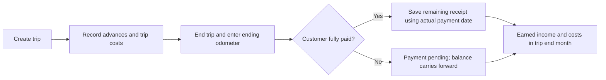
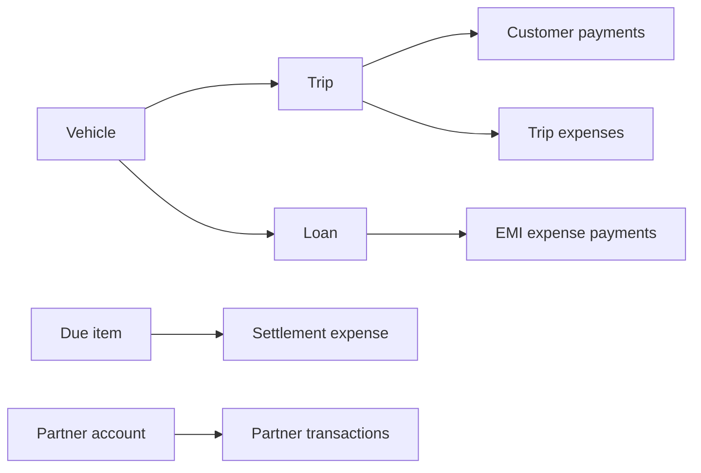
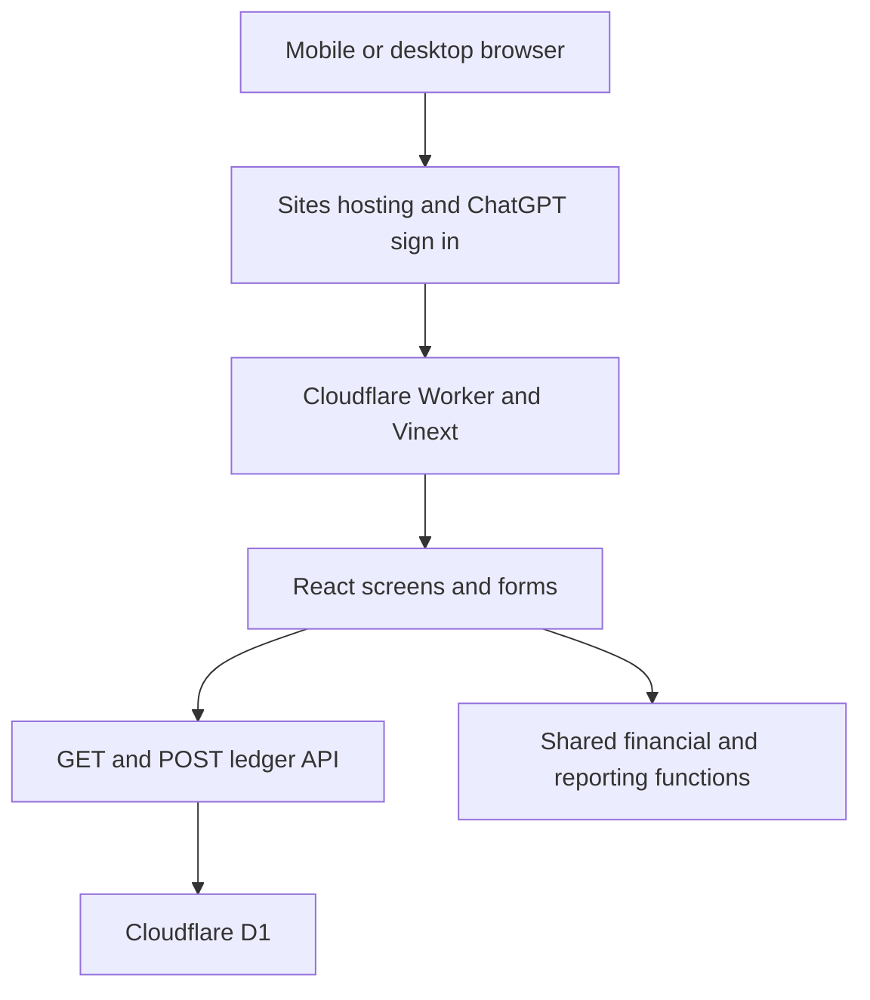

# Current update — 18 October 2026

The shared overlay calendar handles all date/month selection without moving form fields. Add trip keeps Trip details, Expenses and Payments tabs and defaults to Completed — paid. New paid trips use their end date for the receipt; settling an existing payment-pending trip defaults to today, with a Change control for the actual date. Payment method is no longer requested. Cancellation/refunds live in Trip details. Trips lists and normal details show current payment state; monthly reports and exports keep historical month-end cutoffs. No existing payment history is rewritten. See [Wrap-up](WRAP-UP.md) and [Simple flows](SIMPLE-FLOWS.md).

# PIKU Holidays Ledger Application Blueprint

Business workflows and technical reference

Version 1.1 · 10 October 2026 · Current implemented application

**Updated 18 October 2026:** daily entry now uses shorter forms, report tabs and automatic EMI deductions in the scheduled due month. See [Simple flows](SIMPLE-FLOWS.md) for the current EMI examples. Existing payment history is preserved; historical results can change because scheduled instalments are now recognised in their due month.

This document describes how we record trips, customer payments, expenses, loan payments and partner transactions in PIKU Holidays Ledger. It explains the current screens, financial rules, data relationships and technical implementation so both partners can use the application consistently and future changes can be reviewed against a shared reference.

Our monthly result uses agreed amounts for completed trips and deducts trip costs, additional business expenses and the full EMI scheduled for that month. Available business cash is calculated separately from actual money received and paid. Customer dues and amounts owed to partners continue into later months until settled.

Application: https://ph-ledger.vercel.app/

Source baseline: f8e0cdf064cbde3b327940d2b1fcba0e84cf976c. This blueprint reflects the monthly report release. Examples use fictional records and INR amounts, not the business's actual balances. Suggested improvements in the final section are not implemented commitments.

## 1 Purpose and application boundaries

We use the ledger to answer five daily questions: which trips are running, what customers owe, what the business owes, which payments are due, and how much cash is available. At month end, we use the same records to understand income, costs and the surplus or shortfall after full EMI deduction.

The application supports a single business with a shared ledger. We can start with one vehicle and add further vehicles through Settings. Partner account records track money owed; login user records control access. A partner account and a login user are separate objects and are not automatically linked.

### Current coverage

| Area | What the application currently supports |
| --- | --- |
| Trips | Multi-day trips, agreed amounts, customer details, odometers, kilometres, status and linked expenses |
| Customer payments | Advances, partial payments, full payments, refunds and payment history |
| Expenses | Trip costs, additional business costs, paid and unpaid entries, category-dependent forms |
| Loans and renewals | EMI schedules, partial EMI payments, principal and interest, due dates and recurring commitments |
| Partners | Repayable contributions, a two-partner 50/50 entry option, partial or full repayments and distributions |
| Reporting | Monthly income and expense statement, cash movements, carried-forward balances, clickable details and CSV export |
| Administration | Owner-managed settings, vehicle and partner setup, user activation, record exports and recent changes |

### Reading the blueprint

Sections 2 to 6 describe the screens and daily workflows. Sections 7 to 9 explain calculations, monthly reports and worked examples. Sections 10 and 11 define business records and database storage. Sections 12 to 14 cover architecture, API behaviour and access controls. Sections 15 and 16 describe verification, operational limits and future changes.

Authenticated screens now enforce a 30-minute inactivity limit with a one-minute warning, cross-tab deadline checks and server-side rejection after expiry. Background refresh does not count as activity. See [Session timeout](SESSION-TIMEOUT.md).

The current owner can transfer ownership from Settings → Business owner with current-password verification and explicit email confirmation. The new owner must be an active partner with a confirmed login that has signed in; the previous owner remains a partner. See [Owner transfer](OWNER-TRANSFER.md).

The current app records a final agreed trip amount. Kilometres are calculated from the odometer readings, but the application does not calculate a quotation from a per-kilometre rate. Monthly review is supported; a month is not formally locked or closed.

## 2 Screens and navigation

Desktop uses a left navigation bar. Mobile uses a bottom bar with shorter labels. Forms and details open in dialogs over the current screen. The selected month can be changed with the month picker or previous and next buttons. Month selection is held in browser memory and resets on a full reload.

| Screen | Main information | Main actions |
| --- | --- | --- |
| Overview | Available cash, customers owe, monthly result, partner debt, recent trips and upcoming commitments | Add a trip, update payment, record expense, partner transaction and open monthly report |
| Trips | Trips intersecting the selected month, status filters, search and customer balances | Add or edit trip, open details, record payments and trip costs |
| Monthly report | Itemised income, expenses, scheduled EMIs, monthly result, cash movements and month-end balances | Select month, open any entry and download formatted Excel or CSV |
| Expenses and dues | Expense history by expense month, renewals and dues, vehicle and purchase EMI plans | Record expense, add due date, record commitment payment and owner loan setup |
| Partners | Partner balances and monthly contribution, repayment and distribution history | Record contribution, repay partner or distribute money |
| Settings | Business settings, opening balances, vehicles, partner accounts, owner user management, backup and recent changes | Configure business and accounts, activate users, export records |

A dashboard due date is compared with today's India business date to mark it overdue. The Expenses and dues commitment list covers current upcoming and overdue items across months. In the monthly report, unpaid commitments are evaluated historically as of the selected month end.

Global search covers trips, expenses, partner accounts and loans where the search field is displayed. Trips also have a customer and trip name filter; expenses and partner transactions have category or type filters.

### Details and sample workspace

Trip details show the customer, dates, vehicle, odometers, kilometres, agreed amount, expenses, profit, customer balance, payments and notes. Report rows open read-only details before offering edit or payment actions. Closing a report detail returns to the report. A report's trip payment history and balance use the selected month-end cutoff.

View sample opens an independent, in-memory demonstration ledger. Changes in that workspace do not enter the hosted database. Reloading discards those sample edits. Sample mode illustrates the experience; production validation and access controls belong to the server.

## 3 Trip and customer payment workflow

### Create and complete a trip

1. Select Add a trip and enter its name, date range, starting odometer and agreed INR amount. Customer name, phone and notes are in Optional details.
2. Choose a vehicle when more than one exists. The first vehicle is selected by default.
3. New trips default to Completed — paid. Choose Upcoming for a journey that has not ended. Advances and partial receipts can be entered in the Payments tab.
4. Add diesel, driver, permits, fines and other trip expenses in the Expenses tab or later from Trip details.
5. Enter the ending odometer. Completed — paid saves the remaining receipt with the trip. New completions use the end date; later settlement of an already-ended trip defaults to today. Use Change for a different actual payment date. Choose Completed — payment pending to keep the balance outstanding.
6. Both ended choices count agreed income and trip costs in the trip end month. Payment records determine actual cash and any customer balance.

The trip form permits trips lasting one day or several days. End date must be on or after start date. Ending odometer cannot be below the starting reading. Completing an ordinary trip requires an ending odometer. Kilometres are ending reading minus starting reading; an unfinished reading is shown as pending.

### Receive payments and issue refunds

Select Update payment for advances and partial receipts; choose the trip, payment date, amount and optional notes. Settle an ended trip by editing it to Completed — paid. Refunds and cancellation are in Trip details. New receipts use the internal method Other; existing methods remain stored. Advance, partial and full payments use the same receipt record; the difference is the amount remaining against the agreed trip value.

Customer receipts are summed by payment date. Refunds subtract from receipts and increase the remaining balance. A refund cannot exceed money already received as of its date. Overpayments are allowed and shown as customer credit. The headline Customers owe total adds only positive balances; credit on one trip does not offset another customer's debt.

Cancelling a trip with a positive net receipt requires confirmation of the full refund and actual refund date. The cancellation and refund are saved together; alternatively, record refunds separately from Trip details. A cancelled trip creates no agreed income, but its recorded trip costs remain a loss in its end month. The application does not model a cancellation fee or forfeited advance separately.

### Opening customer dues

The owner can add an opening customer balance from Settings. This is represented as a flagged opening trip and remains collectible. It creates no new trip income. New opening records should describe the customer's unpaid amount at ledger start, not re-enter a historical trip's full revenue.

## 4 Expense entry and recurring commitments

The expense form changes according to category so daily entry stays short. Trip expenses have an actual expense date; business expenses have an expense month that defaults to the current month. All have a description, amount and optional notes. A paid expense also has a payment date. For non-EMI entries, an unpaid status and due date can be recorded.

| Category | Additional fields and behaviour | Monthly treatment |
| --- | --- | --- |
| Diesel, driver, permit, trip fine, other trip expense | Related trip is required; its vehicle is selected from the trip | Recognised in the completed or cancelled trip's end month |
| Insurance | Optional vehicle, paid status, payment date, next insurance renewal and repeat frequency | Full amount in its expense month |
| Road tax | Optional vehicle, paid status, payment date, next road tax due date and repeat frequency | Full amount in its expense month |
| Maintenance, other business expense | Optional vehicle and payment status; no renewal fields | Full amount in its expense month |
| Loan EMI | Loan, instalment, payment amount, payment date and optional principal and interest | Scheduled instalment deducted in due month; confirmed payment changes cash |

An unpaid expense changes the relevant monthly cost and creates a commitment, while cash remains unchanged until paid. Business expense history uses expense month, while trip expense history shows the original expense date; the monthly report applies the recognition rules above. Consequently, a trip cost may appear in one month's expense history and another month's result.

### Add and settle a due item

We can create a standalone commitment with name, category, expected amount, due date, vehicle and repeat frequency. It is a planned payment, not yet a recognised expense or cash movement. Select Record payment on the commitment to create the paid expense and settle the due item together.

Standalone due settlements currently require the full recorded amount. To change the expected amount, edit the unpaid due item before settling it. Ordinary unpaid non-EMI expenses are marked paid through their existing expense record. Partial payments against these ordinary costs are not modelled as a separate settlement ledger.

### Recurrence and renewals

Repeat choices are One time, Monthly, Every 15 days, Quarterly and Yearly. Settling a repeating standalone due item creates its next occurrence based on the previous scheduled due date, rather than the date of late payment. Every 15 days means a rolling 15-day interval, not two fixed days of each calendar month.

Entering a next renewal date on a direct insurance or business expense creates a linked renewal commitment. Its default expected amount comes from that expense and can be reviewed before payment. Editing or clearing an unpaid linked renewal is controlled through the originating expense. A paid commitment is protected from direct editing. Reminders are shown inside the application; email, SMS and push notifications are not implemented.

## 5 Vehicle loans and EMI tracking

The owner sets up the loan with lender or loan name, vehicle, start date, first EMI due date, EMI amount, total instalments, instalments paid before ledger start, optional principal outstanding at ledger start and notes. This creates a calculated schedule that automatically contributes each full instalment to its due month's result. Only confirmed payments reduce actual cash. The same record type supports purchase EMI plans, with an optional down payment recorded once.

Each instalment's date is calculated from the original first-due date. For an anchor of 31 January, the following dates are 28 February and 31 March in a non-leap year. Short months clamp to their final day without shifting later months away from the original anchor.

### Record a full or partial EMI

1. Open Expenses and dues and select Record payment for the scheduled instalment.
2. Enter the actual amount paid and payment date. A partial payment is allowed.
3. Enter principal or interest if known. The form calculates the other part from the total. Both values must add up to the payment.
4. Save. Cash and the monthly result reduce by the full amount actually paid.
5. Continue paying the remaining scheduled amount later. The instalment counts as paid only once fully settled.

| Example instalment | Amount in INR |
| --- | --- |
| Scheduled EMI | 22,500 |
| First partial payment | 10,000 |
| Remaining commitment | 12,500 |
| Second payment to complete it | 12,500 |

The loan view shows paid and remaining instalments, the next unpaid scheduled date and recorded payment history. If opening principal is provided, displayed remaining principal subtracts the principal portions entered for later EMI payments. Missing splits make that estimate incomplete; the app does not calculate an amortisation schedule from an interest rate.

The main monthly result follows our agreed rule: deduct the full EMI scheduled in its due month. A separate operating-profit figure excludes the EMI, while profit after loan interest deducts only known interest. If any scheduled EMI lacks a complete interest split, the report asks for the split rather than presenting a complete profit-after-interest figure.

The server rejects payments above an instalment's EMI value or against instalments already counted as paid before ledger start. Once payments exist, the schedule's EMI amount, total count, first due date and opening paid count cannot be changed directly. Variable EMIs, loan prepayments and interest recalculation require a future design change.

## 6 Partner contributions repayments and distributions

A partner account has a name, opening amount owed and notes. The opening amount records an existing debt to that partner at ledger start; it does not add cash again. Both users with daily transaction access can record money contributed or paid to a partner account.

| Transaction | Effect on business cash | Effect on amount owed to partner | Effect on monthly result |
| --- | --- | --- | --- |
| Contribution | Increases | Increases | None |
| Repayment | Decreases | Decreases | None |
| Distribution | Decreases | None | None |
| Opening amount owed | None | Establishes opening balance | None |

### Cover a shortfall

Select Partner transaction, choose Contribution, select the partner, date and amount, and record why the money was added. Contributions are repayable by default. When exactly two partner accounts exist, a new contribution can be split 50/50. One entry action saves two separate partner transactions. An odd paise is assigned to the second partner so the two entries match the total exactly.

The app does not require a contribution to equal that month's loss. Record the money actually transferred into the business. It may cover a cash shortage caused by customer dues or EMI payments even when the monthly result is positive.

### Repay later

Choose Repayment for the relevant partner and enter the actual date and amount. Full and partial repayments are supported. The remaining balance appears in future month-end reports until cleared. Server checks run through dated transactions to prevent a repayment exceeding the balance owed on its date. A distribution cannot settle that contribution debt.

### Retain and distribute money

Retained money stays in business cash; retaining it needs no new transaction. The owner can set a protected business reserve, which reduces the displayed cash available after commitments. It does not transfer money, add an expense or reduce bank cash.

To distribute, record a Distribution with partner recipient, date, amount and notes. No automatic equal split, profit allocation or dividend entitlement is calculated. The current app shows available cash but does not automatically block a distribution or repayment merely because it would make cash negative. Review cash, unpaid commitments and partner debt before deciding the amount.

## 7 Financial calculation rules

All stored money uses integer paise. Entry forms use INR rupees and convert to paise when saving; display uses Indian currency grouping. Business dates are stored as YYYY-MM-DD and reporting months as YYYY-MM. Today's business date follows Asia/Kolkata.

### Trip calculations

Total kilometres = ending odometer minus starting odometer. Net customer receipts = receipts minus refunds. Customer balance = agreed amount minus net receipts through the cutoff date. Trip profit = agreed amount minus all linked trip costs. For cancellation calculations the agreed income is zero. The trip's displayed agreed amount still preserves the original recorded agreement.

### Monthly result

| Measure | Calculation and date basis |
| --- | --- |
| Trip income | Agreed amounts of completed, non-opening trips ending in the selected month |
| Trip expenses | All linked costs of completed or cancelled non-opening trips ending in that month, regardless of cost date or paid status |
| Additional business expenses | Non-trip, non-EMI expenses for the selected expense month (original date month for older records), including unpaid entries and purchase down payments |
| Scheduled EMI | Full instalments due in the selected month, including amounts not yet paid |
| Total expenses | Trip expenses plus additional business expenses plus scheduled EMI |
| Monthly result | Trip income minus total expenses |
| Operating profit before EMI | Trip income minus trip expenses minus additional business expenses |
| Profit after loan interest | Operating profit minus known interest attributed to scheduled instalments, complete only when every scheduled EMI has a complete split |

### Cash and balances

Cash at month end = opening cash plus customer receipts and partner contributions since ledger start, minus customer refunds, paid expenses, actual EMI payments, partner repayments and distributions through month end. Expenses use payment date, with expense date as fallback; customer and partner transactions use their transaction date.

The cash statement's brought-forward balance plus this month's inflows minus outflows equals month-end cash. In the ledger's first month the opening settings balance is included. A report before ledger start has no ledger cash movements or opening cash.

Customers owe = the sum of positive trip balances for non-cancelled trips whose start date is on or before month end. Business owes partners = opening amounts owed plus contributions minus repayments through month end. Both include carried-forward balances from earlier months.

Cash after commitments = month-end cash minus amounts still unpaid and due on or before that month end. Cash available after commitments and reserve = cash after commitments minus protected reserve. Future due dates after the selected month end are not deducted in this figure. Partner debts are displayed separately and are not automatically subtracted from available cash.

## 8 Monthly report and month end review

The Monthly report screen brings the month's recognised income and expenses into one statement, with individual entries underneath each subtotal. It uses the same financial calculation functions as the Overview, so the totals follow one rule set.

### Report sections

1. Trip income with completed trip rows, customer and trip end date.
2. Trip expenses with category, related trip, original expense date and historical paid status.
3. Additional business expenses such as insurance, road tax, maintenance and fines.
4. Scheduled EMI deductions and monthly surplus or shortfall, with operating and interest-based profit figures.
5. Actual cash movements with brought-forward cash, inflows, outflows and closing cash.
6. Customer balances and partner balances carried forward through month end.
7. Unpaid commitments due through that month end, followed by the cash-after-commitments and reserve calculation in the cash section.

Each list entry opens its underlying details. A customer row opens the trip; an expense or payment opens a detail view with related records; a partner balance opens its account and dated transactions; an unpaid EMI opens its scheduled commitment. A historical commitment already settled later cannot be paid again from that report.

### Monthly review sequence

1. Finish the month's trips and confirm odometer readings and agreed amounts.
2. Enter all trip costs, business costs, paid EMIs, receipts and refunds.
3. Review unpaid expenses and ensure the same cost has not also been entered as a duplicate standalone commitment.
4. Open the month report and compare customer balances with expected collections.
5. Check partner contributions and repayments against actual transfers.
6. Compare calculated cash with combined cash and bank funds, then review due items, partner debt and reserve.
7. Record actual repayments or distributions when paid and export the updated report.

The CSV includes summary measures and individual rows for income, trip costs, business costs, EMIs, cash movements, customer balances, partner balances and unpaid commitments. It includes dates, descriptions, details, notes and record IDs. A full ledger JSON export is available separately in Settings.

Reports are recalculated from the current records. Editing an old trip, cost, payment or opening setting may change a past report; reports are not immutable month-close snapshots. Standard trip details outside the report show all recorded payments rather than the selected report's historical cutoff.

## 9 Worked financial examples

These examples explain the rules using fictional amounts. They are not a forecast or a statement of the business's actual performance.

### A profitable month with a lower cash balance

Assume opening cash of INR 10,000. Completed trips have agreed income of INR 100,000 and trip costs of INR 40,000. Additional business costs are INR 10,000. A paid EMI of INR 20,000 consists of INR 16,000 principal and INR 4,000 interest. Customers pay INR 70,000 during the month. A partner adds INR 5,000, receives INR 3,000 repayment, and receives INR 2,000 distribution. All stated costs are paid in the month, with no other unpaid commitments or opening partner debt.

| Measure | Amount in INR |
| --- | --- |
| Trip income | 100,000 |
| Total expenses including full EMI | 70,000 |
| Monthly surplus after EMI | 30,000 |
| Operating profit before EMI | 50,000 |
| Profit after EMI interest | 46,000 |
| Closing business cash | 10,000 |
| Customer amount still owed | 30,000 |
| Remaining amount owed to the contributing partner | 2,000 |

Closing cash is 10,000 + 70,000 + 5,000 − 40,000 − 10,000 − 20,000 − 3,000 − 2,000 = INR 10,000. Unpaid customer income explains why the monthly surplus is greater than the cash retained. The distribution does not reduce the INR 2,000 still owed to that partner.

### A loss funded by two partners

If income is INR 40,000, trip costs INR 30,000, business costs INR 5,000 and paid EMI INR 15,000, the monthly result is a shortfall of INR 10,000. With zero opening cash and all income collected and costs paid, the cash shortage is also INR 10,000. A 50/50 contribution adds INR 5,000 from each partner. Cash becomes zero and each partner is owed INR 5,000.

Next month, repaying Partner A INR 2,000 and Partner B INR 1,000 leaves balances of INR 3,000 and INR 4,000 respectively. Those balances continue into subsequent reports. Repayments reduce next month's cash, while its monthly profit calculation remains unchanged.

### A trip crossing two months

A trip starts 30 October and ends 2 November. Agreed amount is INR 40,000. An advance of INR 20,000 and diesel cost of INR 15,000 are paid in October. October cash increases by INR 5,000; that trip contributes no October income or recognised trip cost. In November, marking it completed recognises INR 40,000 income and INR 15,000 trip cost. Its INR 20,000 customer balance remains collectible until received.

## 10 Business records and field dictionary

Each record has an ID, kind and optional notes. Stored records also have a version and update timestamp. Money fields below are integer paise in storage, even though forms show INR rupees.

### Trips and customer payments

| Record | Fields | Relationships and derived values |
| --- | --- | --- |
| Trip | Name, customer, phone, vehicle ID, start and end dates, starting and ending odometers, agreed amount, status, opening flag, notes | One vehicle; many payments and trip expenses. Kilometres, receipts, balance and profit are calculated |
| Payment | Trip ID, amount, date, receipt or refund type, method, notes | Belongs to one trip; affects cash by date and that trip's customer balance |

Stored trip statuses are Upcoming, Completed and Cancelled, plus legacy In progress records displayed as Upcoming. The form offers Completed — paid, Completed — payment pending and Upcoming. Both completed choices store Completed; dated receipts/refunds determine whether a balance remains. Cancellation is a separate Trip details action. Opening trips represent customer receivables brought into the ledger.

### Expenses and commitments

| Record | Fields | Relationships and derived values |
| --- | --- | --- |
| Expense | Category, description, amount, expense date, payment date, paid status, optional trip and vehicle IDs, optional due and next renewal dates, recurrence, notes | A trip cost requires a trip. A business expense cannot be assigned as a trip cost |
| EMI expense fields | Loan ID, instalment index, principal and interest where known | EMI is an expense record; instalment indices start at zero internally and are displayed as EMI 1, EMI 2 and so on |
| Linked settlement field | linkedDueId on the expense | Connects an actual full payment to a scheduled due record |
| Due item | Name, category, amount, due date, optional vehicle, recurrence, optional paid date, notes | Independent schedule or a renewal created from an expense; remaining amount and historical status are calculated |
| Loan | Name, vehicle ID, start date, first due date, EMI, total count, opening paid count, optional opening principal, notes | Due occurrences are generated from this record and reduced by linked paid EMI entries |

New renewal entry focuses on insurance and road tax. Older standalone due categories remain readable/importable for compatibility. New fines are trip expenses. Loan instalments are generated from the loan rather than stored as ordinary due records. A linked direct renewal uses an ID derived from its originating expense.

### Partners and vehicles

| Record | Fields | Relationships and derived values |
| --- | --- | --- |
| Partner | Name, opening amount owed, notes | Many contribution, repayment and distribution records; balances calculated through a cutoff |
| Partner transaction | Partner ID, date, amount, contribution or repayment or distribution type, notes | Belongs to one partner account; does not require that partner to have a login |
| Vehicle | Name, registration, notes | Referenced by trips, loans, applicable expenses and due items |

Customer details currently live on each trip; there is no separate customer master record. Likewise there is no driver master record, supplier ledger, expense attachment or payment account record. The application calculates a combined cash figure rather than separate cash, bank and UPI balances.

## 11 Database structure and relationships

The hosted app uses Cloudflare D1 with a SQLite-compatible schema. Four physical tables support the ledger. Business record kinds share one records table; their category-specific fields are stored as JSON and validated in the application.

| Table | Key columns | Purpose |
| --- | --- | --- |
| business | id, owner_id, settings, revision | One business row identified as main; settings JSON and ledger-wide write revision |
| members | email, name, role, active | Login authorisation by email; active partner access and owner display record |
| records | id, kind, data, version, updated_at | Trips, payments, expenses, partners, partner transactions, loans, vehicles and due records |
| audit | id, record_id, action, actor, at, before, after | Dated change records with actor and before/after JSON where recorded |

The relationships below are logical application links. The current records table does not define separate relational foreign-key constraints for each JSON reference. The API validates reference existence and kind before writing.

The business settings JSON contains name, ledger start date, opening cash and protected reserve. Members are separate from partner accounts. The current storage is designed for one business, not multiple businesses sharing one deployment.

Versions protect individual record edits and deletes. The business revision protects a batch against a concurrent ledger update after server validation has read its records. Main changes, audit rows and revision increment are sent as one atomic D1 batch. A stale revision guard causes the whole write to abort.

Opening values are recorded once, then calculations add later movements. Month totals, customer balances, partner balances, generated EMI schedules and available cash are derived values; they are not separate stored monthly total rows. This keeps reports consistent with the underlying entries but means edits can alter historical results.

A JSON backup contains settings, business records, export time and the sample indicator. It does not include the complete members table or audit table. Downloading that file does not create an automatic restore point or implement a restore operation.

## 12 Technical architecture and source structure

The application is a React client interface rendered through Vinext with Next-compatible APIs. A Cloudflare Worker serves the app and its ledger API. Sites provides hosting and ChatGPT sign-in. Cloudflare D1 persists real ledger data. The current hosting manifest uses the DB binding and no R2 file storage.

### Source responsibilities

| Source file or folder | Responsibility |
| --- | --- |
| app/page.tsx and app/layout.tsx | Application entry and page metadata |
| app/ledger-app.tsx | Navigation, main screens, shared dialogs, daily entry, data fetching and exports |
| app/monthly-report.tsx | Itemised monthly statement and report record detail views |
| app/globals.css | Responsive desktop and mobile presentation |
| lib/ledger.ts | Money, date, trip, partner, commitment and monthly calculation functions |
| lib/report.ts | Itemised report selection, cash reconciliation and CSV rows |
| lib/validation.ts | Zod record, settings and user schemas |
| app/api/ledger/route.ts | Authentication context, permissions, validation, reads and atomic writes |
| app/chatgpt-auth.ts | Reading Sites-authenticated identity and sign-in paths |
| db/schema.ts and drizzle | Database schema and migration history |
| lib/demo.ts and tests/ledger.test.mjs | Demonstration records and financial scenario tests |
| .openai/hosting.json and build scripts | Site identity, D1 declaration and deployment integration |

Real financial records are fetched from the API and kept in React memory. They are not saved to browser localStorage. The UI refreshes on visibility changes and every 45 seconds while visible, with a manual refresh control. This is polling, not instantaneous push synchronisation.

Views share the root page and use client state rather than separate screen URLs. Changes are validated by the server and then reloaded. Monthly reports are computed from the authorised record dataset in the browser; there is no separate monthly-report endpoint or persisted report snapshot.

Source is maintained in Git and deployed through the Sites source and build workflow. Local preview uses a separate D1 database persisted in .wrangler/state. Local test data does not automatically migrate into hosted business records. Applied migration files should remain unchanged; later schema changes need new migrations.

## 13 API contract and save lifecycle

All business operations currently use /api/ledger. GET and POST responses are JSON with Cache-Control set to no-store. The API requires the Sites-authenticated user context and access to the D1 binding.

### Supported operations

| Request | Input | Result |
| --- | --- | --- |
| GET /api/ledger | Authenticated request | Records, settings, user identity, owner-only member list and recent audit summaries |
| POST action save | entry, or entries array | Creates or updates validated records; a batch accepts 1 to 20 entries |
| POST action delete | id and version | Removes an eligible record and records the change |
| POST action settings | settings object | Owner-only business configuration update |
| POST action member | member object | Owner-only addition, update or activation of a partner login |

Successful writes return an ok response. The UI reloads the ledger after success. Validation errors return readable messages. Statuses include 401 for sign-in, 403 for access or role failure, 404 for an absent record, 409 for a stale edit or conflicting payment, and 503 when the database binding is unavailable. Other validation failures generally use 400.

### How a save works

1. The UI converts rupee input to integer paise and prepares the relevant category fields.
2. The server checks the request origin where supplied, reads authenticated identity and resolves business membership.
3. It parses the requested action and record schemas, reads current records and constructs the effective set with proposed changes.
4. It checks dates, record links, owner-only actions, record versions, dated refund and repayment balances, and loan payment limits.
5. It prepares record writes, any commitment settlement or next occurrence, and audit entries.
6. It commits the guarded atomic batch and increments the business revision.
7. The UI reloads records and recalculates the dashboard and report values.

An advance entered during new trip creation saves the trip and receipt as one batch. A two-partner 50/50 contribution similarly saves two transactions. These actions avoid requiring the user to manually create matching entries.

The current API loads the full ledger record set for validation and returns all authorised business records on GET. It has no pagination, server report aggregation or dedicated full-text search. For a small ledger this keeps the implementation simple; growth may require query and indexing changes.

## 14 Permissions and record safeguards

There are two permission levels: Owner and Partner. Hosting permission to visit the private site and ledger permission to use its data are separate checks. Adding a login email in Settings authorises the user inside the ledger; the owner must separately allow that person through the site's hosting access controls.

| Capability | Owner | Active partner user |
| --- | --- | --- |
| View business records and monthly reports | Yes | Yes |
| Manage normal trips and customer receipts or refunds | Yes | Yes |
| Manage daily expenses, due items and EMI payments | Yes | Yes |
| Record contributions, repayments and distributions | Yes | Yes |
| Export reports and ledger records | Yes | Yes |
| Change business settings and opening customer balances | Yes | No |
| Set up or change vehicles, loans and partner accounts | Yes | No |
| Add, activate or deactivate login users | Yes | No |
| Change business owner through Settings | No | No |

The first authenticated visitor initializes a fresh business as owner. Initial deployment therefore relies on private hosting access until the intended owner has opened it. Ownership is tied to the authenticated account user ID; partner access is looked up by normalised email and active membership.

Actual customer payments, partner transactions and paid expense dates cannot be in the future. Transactions cannot predate ledger start except eligible opening entries. Record references must point to existing objects of the correct kind. Refunds cannot exceed dated receipts; repayments cannot exceed dated partner debt; paid EMI totals cannot exceed an instalment value.

Deleting a referenced setup or trip record is blocked. Removal of certain renewal-linked expenses is blocked so settlement history remains connected. Editing existing paid commitments or changing a loan schedule after payments is restricted. Ordinary eligible deletion removes the business record and leaves an audit entry; there is no user-facing undo or trash restore.

A stale version or ledger revision produces a conflict and asks the user to refresh. Changes are logged, but the UI shows only recent action summaries. GET returns at most 100 summaries and Settings displays the latest six; it does not expose a full audit-history viewer or audit-based restore.

## 15 Verification and operating limits

The monthly report release was checked with TypeScript, a production build, financial scenario tests and local desktop and mobile preview. The financial test suite contains 14 scenarios; it is focused on calculation behaviour rather than end-to-end server security coverage.

### Covered financial scenarios

- Completion-month trip recognition with transaction-date cash and cross-month trips.
- Full EMI treatment, principal and interest distinction, and partial instalment commitments.
- Historical commitments that remain unpaid at a past cutoff despite later settlement.
- Partner contributions, partial repayments, distributions and balance carry-forward.
- Unpaid expense effects, customer refunds, opening customer dues and cancelled-trip costs.
- Calendar day clamping, earlier customer dues and dated later collections.
- Itemised report reconciliation and cash opening, inflow, outflow and closing balance consistency.

### Current limits to consider when using the ledger

Months can be reviewed and exported but not locked. Historical edits update past results. There is no automatic comparison with bank statements and no bank or UPI integration. Negative cash is permitted, so the displayed balance depends on complete and accurate entries.

The reserve and cash-after-commitments calculation does not automatically reserve all partner debt or every future EMI. It deducts commitments through the selected month end and the configured reserve. Distribution decisions remain manual.

Standalone due items require full settlement. Ordinary non-EMI expenses have a paid or unpaid status rather than a partial-payment history. All partner contributions are currently repayable; permanent capital investment is not a separate transaction type.

The application has no formal invoice generation, GST calculation, statutory accounts, customer refund fees, depreciation, rate-per-kilometre quotation or electronic payment collection. Insurance and other business costs are expensed in full in their selected expense month rather than amortised over a coverage period.

There is no offline write queue, instalment interest engine, receipt upload, automated notification delivery, built-in backup restore, scheduled backup job or separate balances by cash and bank account. The source blueprint describes current software behaviour; it does not assert compliance with an accounting or tax standard.

## 16 Future changes and maintenance reference

Future work should preserve the distinction between recognised income, actual cash, customer debt and partner debt. A new field or category should have an explicit date basis and documented effect on each of those values before implementation.

### Suggested next improvements

| Improvement | Why it may help | Design decision needed |
| --- | --- | --- |
| Month review lock and saved report snapshots | Keep reviewed figures stable and make corrections traceable | Reopening permission and correction process |
| Guided opening setup and balance reconciliation | Reduce starting balance and missing-entry errors | Which cash accounts and outstanding items to capture |
| Printable PDF monthly reports | Share a consistent report outside the app | Required report layout and recipient information |
| Notification delivery | Remind users of approaching renewals and EMIs | Channel, timing, recipients and consent |
| Non-EMI partial payments and permanent capital | Support additional real-world settlements | Distinct settlement records and debt treatment |
| Backup import and restore | Recover exported records in a controlled way | Validation, conflict handling and restore permissions |
| Larger ledger queries and vehicle reporting | Support growth beyond the initial van | Pagination, per-vehicle general cost allocation and indexes |

These are suggestions, not changes to the current application or agreed delivery scope. Additional vehicles already have a record structure and selectable trip association; vehicle-specific reporting and allocation of shared business costs need further work.

### Maintenance checks for any financial change

Identify the record affected, the recognition date and actual payment date. Confirm how the change affects monthly result, cash, customer balance, partner debt and unpaid commitments. Preserve paise storage and historical cutoff behaviour. Test edits and deletion where the record has related payments or renewals. Recheck owner and partner permissions at the API, not only on the form.

After implementation, run the relevant scenario tests and TypeScript checks, verify the production build and inspect the affected mobile and desktop flows. Publish through the existing Sites workflow without resetting the D1 ledger. Update this blueprint and its source baseline when the business rules or screens change.

### Source references

This document was derived from README.md, app/ledger-app.tsx, app/monthly-report.tsx, lib/ledger.ts, lib/report.ts, lib/validation.ts, app/api/ledger/route.ts, app/chatgpt-auth.ts, db/schema.ts, the hosting manifest and tests/ledger.test.mjs at the source baseline stated on the first page. File names identify where a future maintainer should confirm behaviour before changing it.
