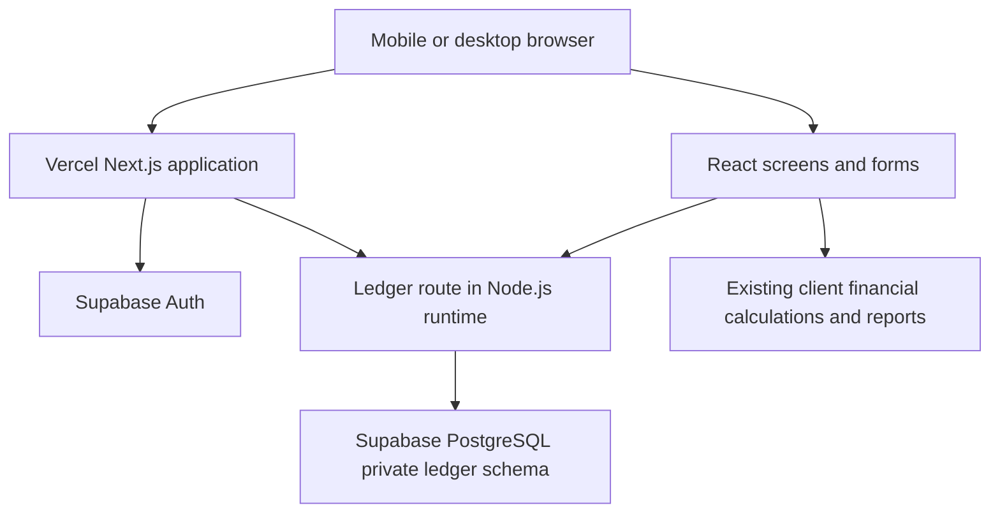

# Vercel migration architecture

The earlier `APPLICATION-BLUEPRINT.md` and Word blueprint document the deployed Sites baseline. This file describes the prepared Vercel version. The Vercel version is not live until account configuration, deployment and data verification are complete.

## Runtime and request flow

The frontend, application API and login pages run on Vercel. Supabase provides PostgreSQL and verified email/password identities. No live financial records are stored in browser localStorage. The dashboard/report calculations retain integer paise and India business dates. Vercel and Supabase should use nearby regions.

## Authentication and authorization

- `lib/supabase/server.ts` creates a cookie-based server client using Supabase SSR.
- `proxy.ts` refreshes sessions and applies private/no-store cache control to relevant routes.
- `lib/auth.ts` calls Supabase `getUser()`, checks the email is confirmed, and returns a verified ID/email. Sites identity headers are no longer accepted.
- `app/page.tsx` redirects signed-out visitors to `/login`.
- `app/login/` supports password sign-in and server-side sign-out.
- `app/account/password/` supports changing a known password, requiring the current password and a 12-character new password.
- `lib/access.ts` only permits the configured `OWNER_EMAIL` to initialize a fresh business. Thereafter owner rights depend on the saved Supabase user ID; changing the environment email does not transfer ownership.
- Active partner memberships are checked on every API request. A confirmed Supabase account by itself grants no ledger access. Owner roles in the member list cannot elevate a different Auth ID.
- Owner-only setup/settings/member permissions remain enforced by the API, alongside existing daily transaction validation.
- Public signup is disabled in Supabase. Accounts are initially created by the administrator in Supabase; app Settings separately grants or deactivates partner access. No external email is automatically sent by adding an app member.

## Data and concurrency

`supabase/schema.sql` creates `ledger.business`, `ledger.members`, `ledger.records` and `ledger.audit`. Financial JSON remains text so the existing record shapes can be imported without changing values. The private schema is not exposed to browser roles: schema/table privileges are revoked for public, anon and authenticated, and row-level security is enabled without browser access policies. The Vercel server connects with a private DATABASE_URL.

`db/index.ts` uses Postgres.js with SSL, `prepare: false` and `max: 1` for Supabase transaction pooling. It creates a lazy, process-local client, not a new pool for each request.

`lib/database.ts` supplies the ledger's small parameterized-statement interface. It explicitly addresses the private schema. Business input is always bound as parameters; it is never interpolated into SQL.

Every mutation locks the `main` business row with `SELECT ... FOR UPDATE`. After acquiring the lock, it checks the revision captured before validation, applies all record/audit statements and increments the revision in one transaction. A concurrent stale mutation fails with 409. Database exceptions are returned with generic messages rather than connection information. The new PostgreSQL implementation replaces the SQLite audit NOT NULL guard used by the earlier Sites version.

## Initial migration

`lib/import-backup.ts` validates the real backup shape, unique IDs, reference kinds, dated transactions, partner repayments/refunds, linked settlements and loan instalment limits. `lib/import-ledger.ts` imports only into an empty ledger, preserves the Supabase owner and active memberships, resets record versions to 1, copies business settings, and records an import audit summary. The transaction/revision guard prevents imports racing with other entries. Limit: backup under 3 MB and no more than 10,000 records.

The API exposes this as owner-only POST action `import`, and Settings provides file selection, a business name/record count preview and explicit submit. A CLI alternative uses the same code after owner initialization. A failed or invalid import leaves all target data unchanged. There is no general overwrite/merge/restore endpoint.

Old financial records migrate through the old site's JSON export. Login accounts and the complete old audit history are absent from that export, so they do not migrate through this flow. Recreate partner access and retain the old site/archive for its existing history. New data on Vercel does not sync back to Sites.

## Deployment files

| File | Responsibility |
| --- | --- |
| `vercel.json` | Next.js deployment, npm install/build and output configuration |
| `.env.example` | Four required variables with safe placeholders and configured owner email |
| `supabase/schema.sql` | Initial PostgreSQL schema, access restrictions and indexes |
| `scripts/setup-database.mjs` | Optional local schema setup using the private database URI |
| `scripts/check-deployment.mjs` | Configuration/schema/private access/public-signup checks; no credential output |
| `scripts/import-ledger.mts` | Optional validated empty-ledger CLI migration |
| `docs/VERCEL-GO-LIVE.md` | Account setup, deployment, data import, verification and switching steps |
| `tests/migration.test.mjs` | PostgreSQL schema, transactions, import and authorization tests |

Legacy Sites helpers, `.openai/hosting.json`, the Vite config and SQLite migrations remain in the original checkout as reference for the old deployment. They are excluded from the prepared Vercel source ZIP, are not called by the new npm scripts and must not be used to publish this Vercel version to Sites. PostgreSQL schema tooling outputs to `supabase/generated-migrations` rather than overwriting the old SQLite migrations.

## Verification and remaining live checks

The existing financial scenario tests exercise completed-trip recognition, full EMI treatment, cash reconciliation, partner balances, customer refunds and historical cutoffs. New tests use embedded PostgreSQL to verify private schema privileges, bound parameters, atomic rollback, stale revisions, import parity/non-overwrite, renewal upserts, owner-only initialization and partner access.

Local tests do not prove real Supabase Auth credentials, pooler connectivity, Vercel environment settings or deployed owner/partner sessions. Those checks require the configured accounts. The go-live guide specifies the production verification before switching.

Monthly locking, bank reconciliation, automated notifications, automatic backups and general backup restore remain separate future work. No financial rules were changed as part of this hosting migration.
